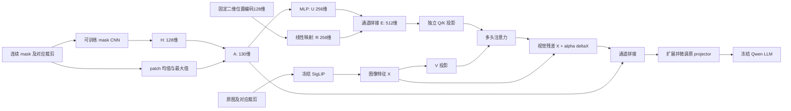

# LLaVA Mask Fusion

基于工作区 `llava_pruning` 的 LLaVA-OneVision / Qwen2 / SigLIP 路径，实现连续专家异常图的双通路融合。新增代码在 `mask_fusion/`；原模型运行时保留在 `vendor/llava/`。

当前入口支持单张原图、多视图（AnyRes/ROI）和多条 QA，训练为单 GPU SFT；也能在 CPU 上运行小模型测试。MuSc V2 作为外部冻结专家，输入它预先生成的连续分数图。本项目不包含 MuSc V2 的生成器、基础模型权重或真实训练数据。

## 模型结构



单个 crop 的默认数据路径如下，省略 batch 维。视觉维度和 patch 大小从加载的 tower 读取；表内数字对应仓库的 SigLIP so400m-patch14-384。

| 阶段 | 计算 | 输出 |
|---|---|---|
| 视觉特征 | `VisionTower(image)` | `729 × 1152` |
| 固定分数缩放 | `mask / 255`，不逐图 min-max、不二值化 | `1 × 384 × 384` |
| mask 编码器 | `Conv(1,128,k14,s14) → GELU → Conv(128,128,k3,s1,p1) → GELU` | `128 × 27 × 27` |
| H | 展平行优先 patch 网格，可选逐 token LayerNorm | `729 × 128` |
| A | `[H; patch_mean; patch_max]` | `729 × 130` |
| U | `Linear(130,256) → GELU → Linear(256,256)` | `729 × 256` |
| R | 行/列整数坐标分别正余弦编码，再 `Linear(128,256)` | `729 × 256` |
| E | **`[U;R]`，无额外压缩线性层** | `729 × 512` |
| 注意力 | 默认对 E 做 LayerNorm，再独立 Q/K 投影；V 来自 X | 8 heads，每头 32 维 |
| 视觉残差 | `X_tilde = X + alpha * W_O(attention(Q,K,V))` | `729 × 1152` |
| projector 输入 | `[X_tilde;A]` | `729 × 1282` |
| projector 输出 | 原有 LLM hidden size，继续原 token 打包流程 | token 数量沿用 baseline |

公式中的位置编码、均值与最大值无可训练参数。CNN、U/R 映射、Q/K/V/O、融合系数和整个 projector 可训练。冻结 vision tower、Qwen 和外部专家；损失仍通过冻结 Qwen 反传到新模块。

默认只用一层注意力，不额外加入视觉 FFN。增加 `num_layers` 时，每层 Q/K 都来自相同的纯 mask/位置先验，V 来自上一层更新后的视觉特征。注意力在每个 crop 内独立计算。

配置见 `configs/default.json`。128/256 维宽度、1 层、8 个头、`alpha_init=0.01`、H/E LayerNorm 都是可修改的起始设置，不是已验证的最优超参数。`normalize_e=false` 可关闭注意力先验的归一化；直接进入 projector 的均值/最大值不经过 H/E 的 LayerNorm。

### 初始化与消融

projector 第一层复制旧视觉列、偏置和所有后续层，新增 130 列初始化为零。注意力使用正常初始化、alpha 从小非零值开始，因此完整模型初始输出不保证与 baseline 严格相同。

四种模式保持相同的扩展 projector 形状：

| config `mode` | projector 输入 | 可训练分支 |
|---|---|---|
| `both` | `[X_tilde;A]` | 全部新增模块 + projector |
| `direct` | `[X;A]` | mask CNN + projector |
| `attention` | `[X_tilde;0]` | mask CNN、先验和注意力 + projector |
| `none` | `[X;0]` | projector，作为相同 SFT 下的图像基线 |

每种模式应从相同原始 checkpoint 独立训练。对应配置为 `configs/default.json`、`direct.json`、`attention.json`、`none.json`。训练数据、裁剪、精度和后端应保持一致。`randomroi` 即使在 none 模式也可能用 mask 选框；若比较“不使用任何专家信息”，请统一使用 `anyres_max_9` 或 `square`。

## 环境

从本项目目录运行命令。真实训练建议使用已有 CUDA 环境，先安装适合硬件的 PyTorch，再安装其余依赖：

```bash
python -m pip install -r requirements.txt
```

接口沿用 baseline 的 `transformers==4.46.1`。默认 decoder 后端为 `sdpa`；如果需要匹配原 `llava_pruning` 的 FlashAttention 2 运行方式，请在安装匹配的 `flash-attn` 后显式设置 `--attn-implementation flash_attention_2`。不要把不同后端/精度的结果当作严格相同的基线运行。

本地验证环境 `.venv` 使用 Python 3.12、PyTorch 2.5.1 CPU、Transformers 4.46.1。它用于测试，不提供 CUDA 训练能力。

## 数据格式

训练、验证、推理共用 JSONL（一行一个对象），也支持 JSON 数组。`image`、`mask` 路径相对 JSON 文件目录解析，或通过 `--data-root` 指定统一根目录。

```json
{"id":"sample_001_q1","category":"bottle","image":"images/001.png","mask":"masks/001.npy","question":"Is there a visible defect?","options":{"A":"No visible defect","B":"A visible defect is present"},"answer":"B"}
```

- `options` 可用 A–H 连续字母的映射或 2–8 项字符串列表；训练答案可用字母或唯一匹配的选项文本，内部统一为字母。
- 普通开放 QA 省略 `options`，`answer` 为文本；推理可以省略 `answer`。
- `category` 用于验证未见产品类别和统计分类别结果。预检要求 `id` 和 `category` 完整。
- mask 支持灰度 PNG/TIFF、二维 NPY，或含 `anomaly_map` 的 NPZ。拒绝 RGB 热力图、NaN、负数和超出配置尺度的有效分数。
- 默认原值范围 0–255，融合模块统一除以 255；若源文件已经统一缩放到 0–1，请将 `score_scale` 显式设为 1，不能再除一次 255。
- `examples/train.jsonl` 仅说明格式，其图像和 mask 路径是待替换的示例，不是可直接训练的数据。

选择题 prompt 明确要求只回答选项字母。SFT 仅监督 assistant 答案和 ChatML 结束 token；system/user、图像和 padding 的标签均为 `-100`。超长文本或图像展开后超出上下文时直接报错，不静默截掉答案。

### 空间对应

默认 `anyres_max_9`，也支持 `square`、`randomroi`、`randompatch`。预处理复用 baseline 真正选出的 crop 和排列，不重新为 mask 抽样框。mask 使用 float32 双线性插值，RGB 使用原 SigLIP processor；相同几何变换不意味着共用 RGB 通道归一化。

patch 统计用真实 kernel/stride=14 的窗口，不能简单用 adaptive pooling 到 27×27 替代。padding 有独立有效性图：均值/最大值排除无效像素，完全无效 patch 不作为注意力 key；其专家特征和注意力增量置零。AnyRes 后续的 unpad、pooling、newline 打包沿用 baseline。

## 先检查跨产品类别划分

```bash
python -m mask_fusion.validate_data --train /path/data/train.jsonl --val /path/data/val.jsonl --test /path/data/test.jsonl --check-pixels
```

默认拒绝跨集合图像路径共享、产品类别共享、同图类别矛盾。统计分别报告 QA 数、独立图像数和类别数。图片副本/近重复图的内容去重仍需在数据整理阶段完成；路径检查不能发现不同文件名的同图。

## 训练

```bash
python -m mask_fusion.train --base-model /path/checkpoints/llava-onevision-qwen2-7b-ov --data /path/data/train.jsonl --val-data /path/data/val.jsonl --require-disjoint-categories --output /path/runs/mask_fusion_both --fusion-config configs/default.json --image-mode anyres_max_9 --batch-size 1 --grad-accum 8 --epochs 3 --lr 1e-4 --projector-lr 1e-5
```

`--base-model` 必须是本地原始 LLaVA-Qwen checkpoint。若其配置中的 SigLIP 路径在当前机器不可用，可加 `--vision-tower /path/checkpoints/siglip-so400m-patch14-384`。不要换成不同结构/权重的视觉塔来加载同一个训练 adapter。

默认启用非重入 gradient checkpointing。`--dtype auto` 在支持时使用 BF16，否则使用 FP32；也可以明确选择 FP16。冻结骨干按选定精度加载，新增模块与 projector 参数保留 FP32，使用 autocast 计算。训练仍需要保存/重算冻结 LLM 的激活，不等同于只运行一个小 CNN 的显存成本。

保存内容：

- `adapter.safetensors`：完整训练后的 projector 和新增融合模块。
- `adapter_config.json`：融合结构、原始 checkpoint 路径、视觉维度和图像模式。
- `tokenizer/`：使用的 tokenizer。
- `training_state.pt`：优化器、学习率调度、随机状态与训练游标，用于显式恢复。
- `training_args.json`：运行参数；每个 epoch 另保存 checkpoint，有验证集时保存最低验证 loss 的 `best/`。

训练结束的输出目录本身可用于推理。恢复中断训练时复用原命令参数并添加：

```bash
--resume /path/runs/mask_fusion_both/checkpoint-epoch-1
```

恢复会检查数据清单和关键超参数一致性；它是继续原训练，不是用旧优化器开始另一份数据的新实验。只对自己保存、可信的训练状态使用 resume。

## 推理与选择题评估

```bash
python -m mask_fusion.infer --adapter /path/runs/mask_fusion_both/best --base-model /path/checkpoints/llava-onevision-qwen2-7b-ov --data /path/data/test.jsonl --output /path/results/predictions.jsonl
```

原 checkpoint 未移动时可省略 `--base-model`。图像模式从 adapter 自动恢复。推理为逐 QA 的贪心生成，默认最多 32 个新 token；开放问答可用 `--max-new-tokens` 增大。

`--base-model` 覆盖只应用于同一原始 checkpoint 的路径迁移。adapter 会检查结构和维度，但不对大模型权重逐文件做内容校验；同结构的另一套权重不能视作等价底座。

输出包括原始回答、解析出的选项和正确与否；旁边的 `.metrics.json` 报告总准确率、各类别准确率、类别宏平均和无法解析的选择题数量。普通文本 QA 保留输出但不自动判定语义正确性。

选择题解析器接受独立选项字母或精确的选项文本，不从任意长句中猜一个字母。无法解析的有标注选择题计为错误并单独报告。

## 验证与当前边界

```bash
python -m unittest discover -s tests -v
```

测试涵盖连续 mask 的真实 crop/patch 对齐、有效像素统计、位置编码与 E 拼接、注意力 padding、可训练参数与梯度、答案标签屏蔽、断点恢复、adapter 往返以及真实 tiny Qwen 的前向和生成。tiny Qwen 随机初始化，视觉塔用无下载的小型替身；这些测试验证代码行为，不验证异常检测准确率。

2026-10-08 验证结果：68 项 CPU 测试全部通过；训练、推理、数据预检三个 CLI 的 `--help` 均通过；新增代码、测试及 vendor Python 源码编译检查通过。FP16 overflow 的控制流程用模拟 scaler 注入溢出验证，尚不等同于真实 GPU FP16 验证。

尚未用真实 7B checkpoint、GPU 和用户数据完成训练或评估。没有报告模型收益或显存/速度结论。当前 CLI 支持单 GPU、单图 QA（含该图多个 crop），不包含多 GPU DDP、量化、视频或多张独立图像对话。

## 代码来源

`vendor/llava` 复制自工作区 `llava_pruning/vendor/llava`，源仓库提交 `75663414c497653d3bb5f4313a1c8af5da304c4c`。保留上游版权头及 `vendor/llava/LICENSE`。

复用：Qwen2/SigLIP、原 projector 结构、AnyRes/ROI 图像处理和视觉 token 打包。

新增：`mask_fusion/` 全部模块、配置、QA 数据入口、训练/推理、adapter 保存加载、数据预检和测试。

vendor 中只接线修改 `llava/model/llava_arch.py` 和 `llava/model/language_model/llava_qwen.py`：传递连续 mask/有效性图、在 vision tower 与 projector 之间调用新模块，并对超长序列显式报错。FastV/ViCo 代码保留，但该项目的 loader 禁用剪枝。
