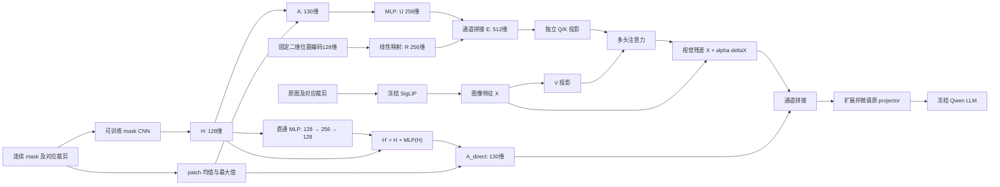

# LLaVA Mask Fusion

基于工作区 `llava_pruning` 的 LLaVA-OneVision / Qwen2 / SigLIP 路径，实现连续专家异常图的双通路融合。新增代码在 `mask_fusion/`；原模型运行时保留在 `vendor/llava/`。

当前入口支持单张原图、多视图（AnyRes/ROI）和多条 QA，训练支持单 GPU 或双 GPU FSDP SFT；也能在 CPU 上运行小模型测试。MuSc V2 作为外部冻结专家，输入它预先生成的连续分数图。本项目不包含 MuSc V2 的生成器、基础模型权重或真实训练数据。

## 模型结构



上图和下表对应一键流程默认的 `configs/residual_mlp.json`，省略 batch 维。旧版 `configs/default.json` 不启用直通残差 MLP，保留为对照。视觉维度和 patch 大小从加载的 tower 读取；表内数字对应仓库的 SigLIP so400m-patch14-384。

| 阶段 | 计算 | 输出 |
|---|---|---|
| 视觉特征 | `VisionTower(image)` | `729 × 1152` |
| 固定分数缩放 | `mask / 255`，不逐图 min-max、不二值化 | `1 × 384 × 384` |
| mask 编码器 | `Conv(1,128,k14,s14) → GELU → Conv(128,128,k3,s1,p1) → GELU` | `128 × 27 × 27` |
| H | 展平行优先 patch 网格，可选逐 token LayerNorm | `729 × 128` |
| A | `[H; patch_mean; patch_max]` | `729 × 130` |
| 直通残差 H' | `H' = H + Linear(256,128)(GELU(Linear(128,256)(H)))`，末层权重和偏置零初始化 | `729 × 128` |
| A_direct | `[H'; patch_mean; patch_max]`，均值/最大值原样拼接 | `729 × 130` |
| U | `Linear(130,256) → GELU → Linear(256,256)` | `729 × 256` |
| R | 行/列整数坐标分别正余弦编码，再 `Linear(128,256)` | `729 × 256` |
| E | **`[U;R]`，无额外压缩线性层** | `729 × 512` |
| 注意力 | 默认对 E 做 LayerNorm，再独立 Q/K 投影；V 来自 X | 8 heads，每头 32 维 |
| 视觉残差 | `X_tilde = X + alpha * W_O(attention(Q,K,V))` | `729 × 1152` |
| projector 输入 | `[X_tilde;A_direct]` | `729 × 1282` |
| projector 输出 | 原有 LLM hidden size，继续原 token 打包流程 | token 数量沿用 baseline |

公式中的位置编码、均值与最大值无可训练参数。CNN、直通残差 MLP、U/R 映射、Q/K/V/O、融合系数和整个 projector 可训练。冻结 vision tower、Qwen 和外部专家；损失仍通过冻结 Qwen 反传到新模块。注意力的 U/E/Q/K 仍使用原始 `A=[H;mean;max]`；直通 MLP 只改变送往 projector 的 H，不处理均值/最大值，也不进入 Q/K 路径。

`num_layers=1` 表示一层 8 头注意力加视觉残差，不额外加入视觉 FFN。直通分支的残差 MLP 是独立的逐 patch 特征变换，不是第二层 Transformer。增加 `num_layers` 时，每层 Q/K 都来自相同的纯 mask/位置先验，V 来自上一层更新后的视觉特征。注意力在每个 crop 内独立计算。

`configs/residual_mlp.json` 在旧 `configs/default.json` 上启用 `direct_residual_mlp=true` 和 `direct_mlp_hidden_size=256`，其余设置相同，包含 `num_layers=1`、8 个头、`alpha_init=0.01` 和 H/E LayerNorm。末层零初始化使新增直通分支初始满足 `H'=H`。这些宽度和层数是可修改的起始设置，不是已验证的最优超参数。`normalize_e=false` 可关闭注意力先验的归一化；直接进入 projector 的均值/最大值不经过 H/E 的 LayerNorm。

旧 adapter 推理时按保存配置恢复旧结构；缺少新增配置字段的旧权重不会自动启用 MLP。需要升级时，显式使用 `--init-adapter 旧目录 --fusion-config configs/residual_mlp.json` 开始新实验：加载兼容的旧权重，并初始化新的残差 MLP；其余架构设置仍须匹配。`--resume` 不允许跨结构恢复旧优化器。

2026-10-13 起，`scripts/train_zero3_2gpu.sh` 默认使用 `configs/default.json`，恢复 `normalize_hidden=true`，保留 `normalize_e=true`。两处归一化分别作用于每个 patch 的 128 维 CNN 特征 H，以及拼接后的 512 维 E；不对原始 mask 做逐图 min-max，也不对直接拼接的异常均值/最大值做 LayerNorm。`num_layers=1` 保持不变：新增模块为一层 8 头注意力加视觉残差，没有额外视觉 FFN。

ZeRO-3 脚本的新默认输出为 `outputs/zero3_2gpu_with_norm`。保留 `configs/no_hidden_norm.json` 用于旧消融实验，该配置只关闭 H 的 LayerNorm，E 的 LayerNorm 仍开启。恢复 H 的 LayerNorm 会新增可训练的缩放/偏置参数，因此旧无 H LayerNorm 的 adapter 不能直接修改保存配置或使用原优化器断点恢复为新结构；使用原始 LLaVA 底座开始新的融合模块/projector 训练。例如：

```bash
bash scripts/train_zero3_2gpu.sh \
  --dtype float32 \
  --image-mode randomroi \
  --fusion-config configs/default.json \
  --output outputs/zero3_randomroi_fp32_with_norm
```

上述命令沿用脚本中已配置的数据列表；若未配置，仍需传入 `--data`。测试时将 `ADAPTER` 指向这一新输出目录，推理会恢复保存的归一化开关和层数。

### 初始化与消融

projector 第一层复制旧视觉列、偏置和所有后续层，新增 130 列初始化为零。注意力使用正常初始化、alpha 从小非零值开始，因此完整模型初始输出不保证与 baseline 严格相同。

四种模式保持相同的扩展 projector 形状：

| config `mode` | projector 输入 | 可训练分支 |
|---|---|---|
| `both` | `[X_tilde;A_direct]` | 全部新增模块 + projector |
| `direct` | `[X;A_direct]` | mask CNN、启用的直通 MLP + projector |
| `attention` | `[X_tilde;0]` | mask CNN、先验和注意力 + projector |
| `none` | `[X;0]` | projector，作为相同 SFT 下的图像基线 |

未启用直通 MLP 时 `A_direct=A`。旧版四种模式的配置为 `configs/default.json`、`direct.json`、`attention.json`、`none.json`；新增 `configs/residual_mlp.json` 是 `both` 模式的直通残差 MLP 版本。每种对照应从相同原始 checkpoint 独立训练，保持训练数据、裁剪、精度和后端一致。`randomroi` 即使在 none 模式也可能用 mask 选框；若比较“不使用任何专家信息”，请统一使用 `anyres_max_9` 或 `square`。

## 环境

从本项目目录运行命令。真实训练建议使用已有 CUDA 环境，先安装适合硬件的 PyTorch，再安装其余依赖：

```bash
python -m pip install -r requirements.txt
```

接口沿用 baseline 的 `transformers==4.46.1`。默认 decoder 后端为 `sdpa`；如果需要匹配原 `llava_pruning` 的 FlashAttention 2 运行方式，请在安装匹配的 `flash-attn` 后显式设置 `--attn-implementation flash_attention_2`。不要把不同后端/精度的结果当作严格相同的基线运行。

本地验证环境 `.venv` 使用 Python 3.12、PyTorch 2.5.1 CPU、Transformers 4.46.1。它用于测试，不提供 CUDA 训练能力。

## 数据格式

训练、验证、推理共用 JSONL（一行一个对象），也支持 JSON 数组。`image`、`mask` 路径相对 JSON 文件目录解析，或通过 `--data-root` 指定统一根目录。

```json
{"id":"sample_001_q1","category":"bottle","image":"images/001.png","mask":"masks/001.npy","question":"Is there a visible defect?","options":{"A":"No visible defect","B":"A visible defect is present"},"answer":"B"}
```

- `options` 可用 A–H 连续字母的映射或 2–8 项字符串列表；训练答案可用字母或唯一匹配的选项文本，内部统一为字母。
- 普通开放 QA 省略 `options`，`answer` 为文本；推理可以省略 `answer`。
- `category` 用于验证未见产品类别和统计分类别结果。预检要求 `id` 和 `category` 完整。
- mask 支持灰度 PNG/TIFF、二维 NPY，或含 `anomaly_map` 的 NPZ。拒绝 RGB 热力图、NaN、负数和超出配置尺度的有效分数。
- 默认原值范围 0–255，融合模块统一除以 255；若源文件已经统一缩放到 0–1，请将 `score_scale` 显式设为 1，不能再除一次 255。
- `examples/train.jsonl` 仅说明格式，其图像和 mask 路径是待替换的示例，不是可直接训练的数据。

缺少 `image`、值为 `null`/空字符串/空列表，或图片文件不存在时，训练、推理和预检会跳过该条记录。训练加载器按文件报告跳过数量及最多三个原因示例，完整来源与原因保存在 `dataset.skipped_records`；预检 JSON 报告提供 `skipped_missing_images` 和 `skipped_records`。记录序号保留为原文件中的位置。图片路径必须是单个字符串，非空列表等未支持的格式仍报错；有图片但缺少 mask、问答无效等错误也仍报错。若整个数据集（预检时的任一指定划分）过滤后为空，会停止并提示检查根目录和图片路径。

选择题 prompt 明确要求只回答选项字母。SFT 仅监督 assistant 答案和 ChatML 结束 token；system/user、图像和 padding 的标签均为 `-100`。超长文本或图像展开后超出上下文时直接报错，不静默截掉答案。

### 原 LLaVA / Triad 对话格式

训练、推理和数据预检也接受下面这种单轮 `conversations` 记录，无需预先转换 JSON：

```json
{
  "id": "sample_001",
  "image": "images/001.png",
  "mask": "masks/001.png",
  "class": "banana_juice",
  "conversations": [
    {"from": "human", "value": "Image:\n<image>\nProduction process: ...\nQuestion: Is the product defective?"},
    {"from": "gpt", "value": "The labels are aligned. Overall, the answer is: No."}
  ]
}
```

`human.value` 转为完整问题上下文，`gpt.value` 转为完整监督答案。输入文本中的一个 `<image>` 标记移除后，由 prompt 构造函数统一插入；生产过程说明和回答正文保留。仅推理时可以只提供一条 `human` 消息。多轮对话、角色顺序错误或多个图像标记会明确报错，不截取第一轮或丢弃后续内容。已有顶层 `question` 的记录继续使用原扁平格式。

类别优先使用 `category`，缺失时依次取 `class`、`sub_dataset`。专家分数图始终读取 `mask`；记录中额外的 `musc_mask`、`muscv2_mask` 不参与选择。没有 `options` 时使用开放式 QA，不会把长回答自动改成选项字母。两种记录格式可以放在同一个文件，也可以使用多个文件混合训练。

### 多个训练与验证文件

训练的 `--data`、`--val-data` 接受一个或多个文件，JSON 数组与 JSONL 可以混用；也可以重复提供同一个选项。文件按传入顺序合并为一个数据集，训练时统一打乱，不对每个文件单独训练或默认均衡采样。

```bash
python -m mask_fusion.train \
  --base-model /path/checkpoints/llava-onevision-qwen2-7b-ov \
  --data /path/product_a/train.jsonl /path/product_b/train.json \
  --val-data /path/product_c/val.jsonl /path/product_d/val.json \
  --require-disjoint-categories \
  --output outputs/multi_file
```

每个文件里的相对 `image`、`mask` 路径默认从该文件所在目录解析。例如 `/data/product_a/train.jsonl` 里的 `images/001.png` 对应 `/data/product_a/images/001.png`。需要统一数据根目录时再显式传 `--data-root`；验证集可使用 `--val-data-root`。同一文件内和不同文件间的 ID 均可重复，原始 ID 保留，训练与预检均按每条记录计数，不按 ID 合并或去重。样本通过源文件路径和记录序号区分；重复传入同一个文件仍会报错。

### 空间对应

默认 `anyres_max_9`，也支持 `square`、`randomroi`、`randompatch`。预处理复用 baseline 真正选出的 crop 和排列，不重新为 mask 抽样框。mask 使用 float32 双线性插值，RGB 使用原 SigLIP processor；相同几何变换不意味着共用 RGB 通道归一化。

patch 统计用真实 kernel/stride=14 的窗口，不能简单用 adaptive pooling 到 27×27 替代。padding 有独立有效性图：均值/最大值排除无效像素，完全无效 patch 不作为注意力 key；其专家特征和注意力增量置零。AnyRes 后续的 unpad、pooling、newline 打包沿用 baseline。

## 先检查跨产品类别划分

```bash
python -m mask_fusion.validate_data --train /path/data/train.jsonl --val /path/data/val.jsonl --test /path/data/test.jsonl --check-pixels
```

默认拒绝跨集合图像路径共享、产品类别共享、同图类别矛盾。统计分别报告 QA 数、独立图像数和类别数。图片副本/近重复图的内容去重仍需在数据整理阶段完成；路径检查不能发现不同文件名的同图。

预检的每个划分也支持多个文件，检查范围是整个合并后的划分，报告同时包含各源文件的统计：

```bash
python -m mask_fusion.validate_data \
  --train /path/product_a/train.jsonl /path/product_b/train.json \
  --val /path/product_c/val.jsonl /path/product_d/val.json \
  --test /path/product_e/test.jsonl \
  --check-pixels
```

## 训练

### 用脚本启动双卡训练

服务器上建议使用 `scripts/train_fsdp_2gpu.sh`。先编辑脚本顶部的两个数组，每行一个文件路径；没有验证集时保留 `VAL_FILES=()`：

```bash
TRAIN_FILES=(
  "/home/yz/xxy/data/qa/train_a.jsonl"
  "/home/yz/xxy/data/qa/train_b.json"
)
VAL_FILES=(
  "/home/yz/xxy/data/qa/val.jsonl"
)
```

以上数据路径是占位示例，需要换成自己的文件。保存后在项目根目录执行：

```bash
bash scripts/train_fsdp_2gpu.sh
```

也可以不编辑数组，直接传参；命令行数据列表会替换脚本中对应的数组：

```bash
bash scripts/train_fsdp_2gpu.sh \
  --data /path/train_a.jsonl /path/train_b.json \
  --val-data /path/val_a.jsonl /path/val_b.json \
  --output outputs/experiment_01
```

脚本默认使用 GPU `0,1`、BF16、每卡 batch size 1、梯度累积 4、3 个 epoch、融合模块学习率 `1e-4`、projector 学习率 `1e-5`，默认输出到 `outputs/fsdp_2gpu`。原始权重路径已设置为 `/home/yz/xxy/data/checkpoints/llava-onevision-qwen2-7b-ov`。脚本切换到项目根目录后运行，因此命令行的相对文件路径以项目根目录为准；数据记录中的相对图像/mask 路径仍按上文的数据规则解析。

可用 `CUDA_VISIBLE_DEVICES=2,3` 切换两张卡、`PYTHON_BIN=/path/env/bin/python` 指定 Python、`BASE_MODEL=/path/checkpoint` 修改底座路径，也可以追加训练参数，例如 `--fusion-config configs/direct.json`、`--save-every-steps 100` 或 `--resume outputs/fsdp_2gpu/checkpoint-epoch-1`。有验证集时脚本默认检查训练与验证的产品类别不重叠，符合未见类别评估目标；如需关闭此检查，可设置 `REQUIRE_DISJOINT_CATEGORIES=0`。

正式运行前可以预览最终命令，预览不会加载模型或启动训练，也不检查数据内容：

```bash
DRY_RUN=1 bash scripts/train_fsdp_2gpu.sh \
  --data /path/train_a.jsonl /path/train_b.json
```

### 单卡训练入口

```bash
python -m mask_fusion.train --base-model /path/checkpoints/llava-onevision-qwen2-7b-ov --data /path/data/train.jsonl --val-data /path/data/val.jsonl --require-disjoint-categories --output /path/runs/mask_fusion_both --fusion-config configs/default.json --image-mode anyres_max_9 --batch-size 1 --grad-accum 8 --epochs 3 --lr 1e-4 --projector-lr 1e-5
```

`--base-model` 必须是本地原始 LLaVA-Qwen checkpoint。若其配置中的 SigLIP 路径在当前机器不可用，可加 `--vision-tower /path/checkpoints/siglip-so400m-patch14-384`。不要换成不同结构/权重的视觉塔来加载同一个训练 adapter。

默认启用非重入 gradient checkpointing。`--dtype auto` 在支持时使用 BF16，否则使用 FP32；也可以明确选择 FP16。冻结骨干按选定精度加载，新增模块与 projector 参数保留 FP32，使用 autocast 计算。训练仍需要保存/重算冻结 LLM 的激活，不等同于只运行一个小 CNN 的显存成本。

保存内容：

- `adapter.safetensors`：完整训练后的 projector 和新增融合模块。
- `adapter_config.json`：融合结构、原始 checkpoint 路径、视觉维度和图像模式。
- `tokenizer/`：使用的 tokenizer。
- `training_state.pt`：优化器、学习率调度、随机状态与训练游标，用于显式恢复。
- `training_args.json`：运行参数；每个 epoch 另保存 checkpoint，有验证集时保存最低验证 loss 的 `best/`。

训练结束的输出目录本身可用于推理。恢复中断训练时复用原命令参数并添加：

```bash
--resume /path/runs/mask_fusion_both/checkpoint-epoch-1
```

恢复会检查数据清单和关键超参数一致性。多个文件会逐一记录路径和内容哈希，并保留文件顺序；增删文件、改变顺序或修改任一文件内容后，不能沿用原断点继续训练。它是继续原训练，不是用旧优化器开始另一份数据的新实验。只对自己保存、可信的训练状态使用 resume。

### 两张 A100 40GB：FSDP 分片训练

单卡入口保持不变。两张卡使用 `torchrun` 和 `--distributed fsdp`，将模型参数分片到两张卡；仅设置 `CUDA_VISIBLE_DEVICES=0,1` 不会把原单进程训练变成双卡训练。当前实现使用 PyTorch FSDP `FULL_SHARD`，不需要安装 DeepSpeed。

以下命令在服务器项目根目录执行。模型路径对应原 LLaVA-OneVision/Qwen2 checkpoint；数据路径需替换。

```bash
CUDA_VISIBLE_DEVICES=0,1 torchrun --standalone --nnodes=1 --nproc_per_node=2 \
  --module mask_fusion.train \
  --distributed fsdp \
  --base-model /home/yz/xxy/data/checkpoints/llava-onevision-qwen2-7b-ov \
  --data /path/to/qa_data/train.jsonl \
  --val-data /path/to/qa_data/val.jsonl \
  --data-root /path/to/qa_data \
  --require-disjoint-categories \
  --fusion-config configs/default.json \
  --image-mode anyres_max_9 \
  --output runs/mask_fusion_fsdp \
  --dtype bfloat16 \
  --attn-implementation sdpa \
  --batch-size 1 \
  --grad-accum 4 \
  --epochs 3 \
  --lr 1e-4 \
  --projector-lr 1e-5 \
  --log-every 10 \
  --save-every-steps 100
```

`batch-size` 是每张卡的 QA 数，因此正常累积组的总 batch 为 `2 × 1 × 4 = 8`，与原单卡 `1 × 8` 相同；若设置 `--grad-accum 8` 则为 16。最后不足一个累积组时按实际组大小缩放。训练数据为保证各 rank 相同更新步数会补齐，补齐可能重复极少数 QA；验证结果需排除补齐样本的重复贡献。

每个 Qwen decoder block、视觉塔、融合模块和 projector 是独立的分片单元，避免将 BF16 冻结参数和 FP32 可训练参数合并成同一 flat parameter。原权重先留在 CPU，再由 FSDP 逐单元迁移分片，避免初始化时先在每卡放完整模型。模型仍只训练原先指定的新模块和整个 projector，冻结的 Qwen 仍传播输入梯度。梯度裁剪使用 FSDP 的全局范数，梯度累积时每个 microbatch 都同步，避免 `no_sync` 保留全量梯度的额外显存。

FSDP 不会把两张 40GB 变成一块直接可用的 80GB：每卡仍需承受当前单元展开的参数、通信缓冲和本卡样本的激活。AnyRes 输入可能产生较长序列，需先在少量有代表性的样本上验证峰值显存。各进程也会在 CPU 读取原 checkpoint，服务器必须有足够主机内存。

所有 rank 参与必要的权重和优化器状态收集，仅 rank 0 写 checkpoint。导出的 `adapter.safetensors` 格式与单卡一致，可以继续用原 `mask_fusion.infer` 在单卡推理。续训使用相同卡数和原超参数，并在双卡命令后添加 `--resume runs/mask_fusion_fsdp/checkpoint-step-100`；不能把单卡优化器状态直接当成双卡训练续训状态。

在服务器运行以下小模型自检，无需下载真实模型权重或准备数据，检查两张 GPU 的梯度更新、冻结参数、adapter 单卡重载和优化器恢复。输出目录需为空或不存在：

```bash
CUDA_VISIBLE_DEVICES=0,1 torchrun --standalone --nproc_per_node=2 \
  tests/fsdp_smoke.py --output runs/fsdp_smoke
```

该脚本通过只说明小模型的 CUDA/NCCL 分布式链路可运行，之后仍需用真实 7B 和少量不同裁剪数的 QA 检查显存及完整数据加载。

## 推理与选择题评估

```bash
python -m mask_fusion.infer --adapter /path/runs/mask_fusion_both/best --base-model /path/checkpoints/llava-onevision-qwen2-7b-ov --data /path/data/test.jsonl --output /path/results/predictions.jsonl
```

原 checkpoint 未移动时可省略 `--base-model`。图像模式从 adapter 自动恢复。推理为逐 QA 的贪心生成，默认最多 32 个新 token；开放问答可用 `--max-new-tokens` 增大。

`--base-model` 覆盖只应用于同一原始 checkpoint 的路径迁移。adapter 会检查结构和维度，但不对大模型权重逐文件做内容校验；同结构的另一套权重不能视作等价底座。

输出包括原始回答、解析出的选项和正确与否；旁边的 `.metrics.json` 报告总准确率、各类别准确率、类别宏平均和无法解析的选择题数量。普通文本 QA 保留输出但不自动判定语义正确性。

选择题解析器接受独立选项字母或精确的选项文本，不从任意长句中猜一个字母。无法解析的有标注选择题计为错误并单独报告。

### Triad 原始 JSONL：yes/no 异常判断

旧测试格式中的 `text` 会在没有 `question` 和 `conversations` 时作为问题，`question_id` 在没有 `id` 时作为编号。保留原始问题和 `mask` 字段，不自动改用 `musc_mask` 或 `muscv2_mask`，也不根据 `gt` 合成训练答案。例如：

```json
{"question_id":"000000000","image":"Traid_eval_data/mvtec/imgs/000000000.png","text":"Is there any defect in this image? If yes, say 'yes', otherwise say 'no'. Then describe it.","gt":1,"class":"toothbrush","mask":"Traid_eval_data/mvtec/masks_muscv2_classnorm_group_score/000000000.png"}
```

这种任务通过显式参数 `--eval-task anomaly` 评分：`gt` 必须为整数 0（正常）或 1（异常），且问题应要求回答是否存在缺陷。程序保留问题原文，只解析回答开头独立的 Yes/No，后面可以接标点、换行和说明文字；不会从描述中搜索 yes/no，也不会猜测 A/B 与正常/异常的对应关系。带结构化 `options` 的选择题继续使用默认 `--eval-task qa`。

对应上述记录，根目录应为 `/home/yz/xxy/data/datasets`，因为记录本身已经包含 `Traid_eval_data/...`：

```bash
CUDA_VISIBLE_DEVICES=0 python -m mask_fusion.infer \
  --adapter outputs/fsdp_2gpu \
  --base-model /home/yz/xxy/data/checkpoints/llava-onevision-qwen2-7b-ov \
  --data /home/yz/xxy/data/datasets/Traid_eval_data/mvtec/question_musc_muscv2_classnorm_group_score.jsonl \
  --data-root /home/yz/xxy/data/datasets \
  --eval-task anomaly \
  --output results/mvtec_final.jsonl \
  --device cuda:0 --dtype bfloat16 --attn-implementation sdpa \
  --max-new-tokens 64
```

`--adapter` 指向实际训练输出目录。未配置验证集时使用输出根目录的最终权重；已配置验证集时可选择验证损失最低的 `best/`。

预测文件保存完整描述、`gt`、`anomaly_prediction`（1/0/null）和 `correct`。指标文件报告 `accuracy`、产品类别宏平均 `macro_category_accuracy`、各类别统计、正常/异常召回率、`balanced_accuracy` 和无法解析数量 `unparseable_anomaly`。无法解析的回答计为错误，仍保留在准确率和对应类别召回率的分母中；测试集只含正常或只含异常时，缺失类召回率及 balanced accuracy 为 null。混淆统计另外列出未解析的正常/异常数量，不能只用 TP/TN/FP/FN 之和当作总样本数。

这套指标只评估 yes/no 异常判断，不自动评价后续描述，也不计算缺少连续模型分数的 AUROC。所有推理模式均在指标文件中记录 `input_records`、`skipped_missing_images` 和跳过记录明细，检查结果时需核对实际保留的测试样本数量。图像与类别必须按预定测试划分独立于训练集。

### 测试时按产品类别替换为 A/B 提示词

在上述异常测试命令中增加 `--anomaly-prompt category-mcq`，即可在内存中替换本次测试的问题。物体类别来自规范化后的 `category`（原始数据兼容 `class`、`sub_dataset`），缺失时明确报错。以 `toothbrush` 为例，模型收到的问题内容为：

```text
Are there any defects on the toothbrush in this image?
A. Yes
B. No
Answer with the option's letter from the given choices directly.
```

类别名中的下划线在提示词中转换为空格，例如 `metal_nut` 显示为 `metal nut`；统计里的类别名保持原值。选项和作答指令各出现一次，不再额外追加默认的选项字母指令。设置了结构化 `options` 的记录可通过 `mcq_instruction` 提供该结尾指令；未设置时沿用原来的默认指令。

```bash
CUDA_VISIBLE_DEVICES=0 python -m mask_fusion.infer \
  --adapter outputs/fsdp_2gpu \
  --base-model /home/yz/xxy/data/checkpoints/llava-onevision-qwen2-7b-ov \
  --data /home/yz/xxy/data/datasets/Traid_eval_data/mvtec/question_musc_muscv2_classnorm_group_score.jsonl \
  --data-root /home/yz/xxy/data/datasets \
  --eval-task anomaly --anomaly-prompt category-mcq \
  --output results/mvtec_category_mcq.jsonl \
  --device cuda:0 --dtype bfloat16 --attn-implementation sdpa \
  --max-new-tokens 64
```

生成后按 A→1（异常）、B→0（正常）与 `gt` 比较，继续输出异常判断的准确率、类别统计和未解析数量。选项解析沿用 MCQ 规则，接受独立字母及精确选项文本，不从长解释里猜选项。`gt` 和正确答案不用于构造提示词，参考 `answer` 只在写出评分结果时生成。

输出的 `question` 保存新题干，`options` 保存 A/B 选项，`mcq_instruction` 保存指定指令；`original_question` 保留输入的原始题目，`choice` 保存解析后的字母。指标文件的 `anomaly_prompt` 记录本次模板。原始 JSON 不会被写回，现有训练权重可直接用于这一测试。默认 `--anomaly-prompt original` 仍使用原来的 yes/no 问题；比较不同模型时应采用相同的提示词模板。

### MVTec 测试：在 A/B 问题前加入类别知识

`--anomaly-prompt category-knowledge-mcq` 使用随项目分发的
`mask_fusion/prompts/mvtec_category_knowledge.json`，覆盖原版 MVTec AD 的 15 个类别、73 种缺陷。
程序按 `category`（兼容原始 `class`、`sub_dataset`）取出正常要求、正常外观变化与该类别全部可能缺陷的简短解释，
然后询问是否异常。图像占位符、A. Yes / B. No 和作答指令仍由原有流程各添加一次。
正常和异常样本使用同一份类别知识，`gt`、参考答案及 `origin_path` 不参与知识选择。
不支持的类别会在生成和写出结果前报错；其他产品可继续使用 `category-mcq`。

沿用已配置的 Linux 路径直接测试：

```bash
bash scripts/test_mvtec.sh
```

脚本默认使用 `outputs/fsdp_2gpu` 的 adapter、`llava-onevision-qwen2-7b-ov` 底座、
`/home/yz/xxy/data/datasets/Traid_eval_data/mvtec/question_musc_muscv2_classnorm_group_score.jsonl` 测试集、
GPU 0 和 bfloat16。图像模式从 adapter 配置读取；若保存的是 `randomroi`，本次仍使用 `randomroi`。
结果保存在：

- `results/mvtec_category_knowledge_mcq.jsonl`：每条预测及实际使用的知识题干。
- `results/mvtec_category_knowledge_mcq.metrics.json`：原有准确率、混淆统计、各类别指标，另记录知识文件版本和 SHA-256。
- `results/mvtec_category_knowledge_mcq_visualizations/`：实际输入的图像、连续 mask 和选区可视化，脚本默认保存全部样本。

可视化按本次数据顺序创建 `00000000/`、`00000001/` 等目录，避免重复 ID 覆盖。
`overview.jpg` 顶部显示真实标签 `GT: NORMAL/ABNORMAL`、模型判断 `Model: NORMAL/ABNORMAL`，
以及 `CORRECT`（绿色）、`INCORRECT`（红色）或 `UNPARSED`（橙色，模型输出无法解析）。
同时显示模型原始回答的预览，完整回答与标签保存在 `metadata.json` 的 `prediction_result` 中。
标注发生在模型生成和评分之后，真实标签不会进入模型输入；单独保存的输入图片不添加文字。
先打开其中的 `overview.jpg`：第一行显示原图上的实际选框、原始 mask 热图和叠加图；
后续每行按模型输入顺序显示 base、ROI 或 AnyRes tile，以及对应 mask 和叠加图。
`view_XX_*_image.png` 由本次输入张量反归一化得到；可视化不会重新随机抽取 ROI。
AnyRes 的选框从 padding 画布坐标映射回原图，精确坐标保存在 `metadata.json` 中。
热图统一使用 `[0, fusion_config.score_scale]`（默认 0–255），不做逐图 min-max，灰色表示无效 padding。
`mask_values.npz` 保存实际输入的浮点 `masks`、布尔 `mask_valid` 以及原分辨率的 `source_mask`；
显示时超出色标范围的值会饱和，但保存的浮点数和模型输入不变。每条预测中记录对应的可视化路径。

```bash
# 不加知识提示，保存实际输入可视化，使用新的结果名
ANOMALY_PROMPT=category-mcq OUTPUT_FILE=results/mvtec_inputs.jsonl bash scripts/test_mvtec.sh
# 仅保存前 20 条的可视化（仍对整个测试集进行推理）
VISUALIZATION_LIMIT=20 OUTPUT_FILE=results/mvtec_preview.jsonl bash scripts/test_mvtec.sh
# 关闭可视化
VISUALIZE=0 bash scripts/test_mvtec.sh
```

可设置 `VISUALIZATION_DIR` 指定一个新的可视化目录；默认目录跟随最终 `--output` 的文件名。
目录必须为空或不存在，避免混入旧实验图片，`--overwrite` 不会放宽此检查。
直接使用 `python -m mask_fusion.infer` 时，可追加 `--visualize`、`--visualization-dir` 和 `--visualization-limit`。
这项功能沿用 adapter 保存的图像模式，不会将 ROI 权重自动切换成 AnyRes。

仅预览命令、切换权重或与原 A/B 提示对照：

```bash
DRY_RUN=1 bash scripts/test_mvtec.sh
ADAPTER=outputs/fsdp_2gpu/best OUTPUT_FILE=results/mvtec_best_knowledge.jsonl bash scripts/test_mvtec.sh
ANOMALY_PROMPT=category-mcq bash scripts/test_mvtec.sh
```

`DATA_ROOT`、`TEST_DATA`、`BASE_MODEL`、`CUDA_VISIBLE_DEVICES` 等也可通过环境变量设置；
额外 CLI 参数可直接追加。选择对照模式建议使用 `ANOMALY_PROMPT` 环境变量，使默认输出名跟随模式改变。
已有结果不会默认覆盖，重新运行需指定新的 `OUTPUT_FILE` 或明确追加 `--overwrite`。
若继续使用之前的 `python -m mask_fusion.infer ...` 命令，只需将
`--anomaly-prompt category-mcq` 改成 `--anomaly-prompt category-knowledge-mcq`，并改用新的 `--output`。

这些描述是待验证的类别检测规则，不能替代正常视觉参考。例如 metal_nut/flip 说明了翻面属于异常，
但没有编造正确朝向面的具体凹槽特征；cable_swap、pill_type 和 misplaced 也依赖预期产品结构或摆放标准。
比较提示词时使用同一 checkpoint、相同数据顺序、seed、mask 和图像模式，同时检查异常召回及正常误报。

## 合成 mask 预训练，再接真实数据 SFT

新增入口 `python -m mask_fusion.pretrain`。第一阶段跳过 vision tower，在其输出位置构造零视觉特征，绕过注意力，只走 `[0; H'; mean; max] → projector → 冻结 Qwen`。启用新配置时 `H'=H+MLP(H)`，旧配置使用 `H'=H`。只更新 mask CNN、H 的 LayerNorm、启用的直通残差 MLP 和 projector 第一层新增的 mask 输入权重；原视觉输入权重、原 bias、projector 后续层、E 映射及注意力均冻结。首层视觉权重与 mask 权重物理拆分，AdamW 的 weight decay 也不会改动冻结部分。冻结 Qwen 仍保留反向传播到输入的计算图。

预训练保存时把首层重新合并为标准 Linear，导出的 `adapter.safetensors` 可直接用于第二阶段的权重初始化。第一阶段新增 mask 列初始为零时，第一次更新主要发生在这些列；列更新后，后续步骤才会给 mask CNN 提供直接通路的梯度。新残差 MLP 的末层也从零开始，因此其首层需要末层先更新才获得非零数据梯度；这是初始化策略的预期行为。

### 一键执行生成、双卡预训练、真实数据 SFT 和测试

修改 [scripts/run_mask_pretrain_pipeline.sh](scripts/run_mask_pretrain_pipeline.sh) 开头的配置区，然后在原来的训练环境运行：

```bash
# 仅打印四个阶段的完整命令，不生成数据、不创建日志、不加载模型
DRY_RUN=1 bash scripts/run_mask_pretrain_pipeline.sh

# 顺序执行全部阶段；任一步失败即停止，日志自动保存
bash scripts/run_mask_pretrain_pipeline.sh

# 同一实验的前两步已完成时，从真实数据训练开始（不是阶段内断点续训）
START_STAGE=3 bash scripts/run_mask_pretrain_pipeline.sh

# 新实验修改名称，各阶段默认输出路径会一起改变
RUN_NAME=mask_residual_mlp_v2 bash scripts/run_mask_pretrain_pipeline.sh

# 旧版无直通 MLP 对照，使用单独目录
RUN_NAME=mask_without_direct_mlp_v1 FUSION_CONFIG=configs/default.json \
  bash scripts/run_mask_pretrain_pipeline.sh
```

一键流程默认使用 `configs/residual_mlp.json`，生成 2,000/200 张训练/验证 mask；预训练和 SFT 均用 GPU `0,1`、FP32、3 epochs、单卡 batch 1、累积 4 步，测试使用 GPU `0`、FP32、类别 A/B 提示词并保存全部可视化。预训练固定 `square`；SFT 默认为 `randomroi`；测试从 SFT adapter 读取图像模式。SFT 通过 `--init-adapter` 接入预训练最终权重，继续训练整个 fusion（包含新直通 MLP）和 projector，vision tower/Qwen 保持冻结。沿用原来的一键命令会进入新的 `mask_residual_mlp_v1` 实验目录；原 `mask_reference_v1` 结果保留。

顶部可修改两份 `TRAIN_FILES`、可选 `VAL_FILES`、三个阶段各自的数据根目录、模型路径、GPU、学习率、epochs、生成数量和输出目录。数组路径用空格或换行分隔，不加逗号。`TRAIN_DATA_ROOT` 沿用此前 `/home/yz/xxy/data`，`TEST_DATA_ROOT` 为 `/home/yz/xxy/data/datasets`；请对应 JSON 内部的相对路径修改。合成数据的两个 root 均自动绑定到生成目录。相对路径统一以项目目录为基准。

默认 `RUN_NAME=mask_residual_mlp_v1` 的输出为：

- 合成数据：`data/synthetic_masks_mask_residual_mlp_v1/`。
- 预训练权重：`outputs/mask_residual_mlp_v1/pretrain/`；SFT 权重：`outputs/mask_residual_mlp_v1/sft/`。
- 阶段日志：`outputs/mask_residual_mlp_v1/logs/{1_generate,2_pretrain,3_sft,4_test}.log`。
- 测试结果：`results/mvtec_mask_residual_mlp_v1.jsonl` 和 `results/mvtec_mask_residual_mlp_v1.metrics.json`。
- 全量可视化：`results/mvtec_mask_residual_mlp_v1_vis/`。

已有数据/训练输出/测试结果不会自动覆盖或跳过；重复全流程使用新的 `RUN_NAME`。`START_STAGE` / `END_STAGE` 取 1–4，例如 `END_STAGE=1` 只生成数据，`START_STAGE=4` 只测试已完成的 SFT。阶段中途失败需要恢复优化器时，使用原单阶段脚本的 `--resume`，不要把 `START_STAGE` 当作断点恢复。

### 生成并检查样本

```bash
python -m mask_fusion.synthetic_masks \
  --output data/synthetic_masks \
  --config configs/synthetic_masks.json \
  --train-count 2000 --val-count 200 \
  --size 384 --seed 0 --preview-count 16
```

`train-count` / `val-count` 是独立 mask 数；默认每张 5 条选择题，包括 normal/abnormal、位置、分数强度、覆盖比例和形状。这里的数量只是可运行示例，不代表验证过的数据需求。同一张 mask 的所有问答放在同一划分，训练/验证的可见像素内容去重，选项顺序会变化，正确答案字母按题型均衡。

输出包含：

- `masks/train/`、`masks/val/`：0–255 单通道原始分数 PNG，不二值化，不做逐图 min-max。
- `train.jsonl`、`val.jsonl`：直接供预训练使用的 QA。
- `train_masks.jsonl`、`val_masks.jsonl`：逐 mask 的统计、标签及像素 hash。
- `preview.png`：训练/验证两类样本预览，使用固定 0–255 灰度显示。
- `generator_config.json`、`summary.json`：实际生成规则、各题型的答案文字及字母分布。

**先查看 `preview.png` 再正式训练。默认 normal/abnormal 是合成规则标签，不是真实缺陷标注，也不是 MuSc V2 的推理阈值。** 2026-10-13 已根据 `outputs/nor` 和 `outputs/abn` 各 5 张参考调整 `configs/synthetic_masks.json`：正常图为低灰度背景与暗灰结构，异常图加入中灰到亮灰区域；取消正常图中的高亮白色噪点，两类共用形状、面积及模糊范围。参考文件是 RGB 截图，排除四边各 3% 后按显示灰度近似匹配，没有把这些数值当作原始专家概率校准。

新配置使用 `label_rule="blurred_peak"`：只在可见区域上做半径 3 的高斯平滑，平滑峰值达到 80 即作为合成 abnormal；不再要求亮区达到固定面积，也不要求 patch 均分达到 140。这样低于 128 的中灰异常和较小连续亮块不会被旧条件直接排除，孤立的单像素尖峰则会被平滑削弱。极小异常仍可能被平滑稀释；这个规则只用于生成阶段的可复算标签。平滑仅计算标签，保存和训练输入仍是未做这一步平滑的连续分数 PNG。`score_threshold=64` 用于覆盖比例与形状题，和异常判别的平滑峰值阈值是两项不同设置。

旧配置保留为 `configs/synthetic_masks_generic.json`，可用 `--config` 显式选择。CLI 不传 `--config` 时读取新的项目配置；Python API 的 `load_config()` / `generate_dataset(..., config=None)` 保留旧规则，调用 API 使用新风格时请显式传入 `load_config("configs/synthetic_masks.json")`。详细数值和局限见 [参考 mask 与生成配置](docs/synthetic_mask_reference.md)。

答案字母均衡不等于答案语义均衡，尤其形状问题可能集中为 compact；查看 `summary.json` 的 `answer_text_counts` 后调整生成配置。生成器拒绝覆盖非空目录，修改分布后请使用新的输出目录。

若之前已经生成过旧版 `data/synthetic_masks`，可改用 `--output data/synthetic_masks_reference`，训练时设置 `SYNTHETIC_DATA_DIR=data/synthetic_masks_reference`；已有 PNG/QA 不会因为修改配置而自动更新。

该 SigLIP 的 patch 为 14×14，384×384 输入实际编码左上 378×378；所有合成答案从保存后的 PNG 可见区域重新计算，避免不可见边缘决定标签。第一阶段只允许 `square`，且训练前检查 mask 和占位图必须匹配 tower 的原尺寸，防止缩放/ROI 改变答案。JSON 的 `image` 字段复用 mask PNG 作为数据接口占位；它不会进入 vision tower，**这些 JSON 不要作为普通真实图像 SFT 数据使用**。

### 双卡预训练

```bash
# 先查看实际将执行的命令，不启动训练
DRY_RUN=1 bash scripts/pretrain_mask_zero3_2gpu.sh \
  --fusion-config configs/residual_mlp.json --output outputs/mask_residual_mlp_pretrain_zero3

# 默认使用物理 GPU 0、1，ZeRO-3，BF16；沿用 FP32 实验可显式覆盖
CUDA_VISIBLE_DEVICES=0,1 bash scripts/pretrain_mask_zero3_2gpu.sh \
  --dtype float32 --fusion-config configs/residual_mlp.json \
  --output outputs/mask_residual_mlp_pretrain_zero3
```

单阶段脚本保留旧默认：读取 `data/synthetic_masks/train.jsonl` 和 `val.jsonl`，使用 `configs/default.json`，输出到 `outputs/mask_pretrain_zero3`。上面的命令显式选择新残差 MLP 配置和独立输出目录。支持 `SYNTHETIC_DATA_DIR`、`BASE_MODEL`、`OUTPUT_DIR`、`DATA_ROOT` 等环境变量，以及 `--data train1.jsonl train2.jsonl` / `--val-data val.jsonl` 多文件参数。相对图片路径默认相对于各 JSON；给合成数据沿用真实数据的 `DATA_ROOT` 会改变解析位置，通常无需设置。修改生成目录可用 `SYNTHETIC_DATA_DIR=新目录`。

沿用已有 DeepSpeed 依赖和 ZeRO-3 配置。预训练阶段冻结大模型仍需要通过 Qwen 做前向和输入梯度反传，因此并非只训练小 CNN 的计算成本。验证集会记录答案 token loss，并按最低验证 loss 保存 `best/`；合成验证 loss 不能代表真实缺陷准确率。

### 用原来的真实数据开始第二阶段

```bash
DATA_ROOT=/home/yz/xxy/data/datasets \
bash scripts/train_zero3_2gpu.sh \
  --init-adapter outputs/mask_residual_mlp_pretrain_zero3 \
  --fusion-config configs/residual_mlp.json \
  --data /absolute/path/train_a.json /absolute/path/train_b.json \
  --dtype float32 --image-mode randomroi \
  --output outputs/zero3_after_mask_residual_mlp_pretrain
```

将 `--data` 和 `DATA_ROOT` 换成原来真实训练使用的值；原脚本已填写 `TRAIN_FILES` 时可以省略 `--data`。`--init-adapter` 仅加载权重，重新初始化优化器、调度器和训练步数，显式允许从预训练 `square` 切换到真实训练的 `randomroi` / `anyres_max_9`。恢复真实图像、注意力和正常训练配置：训练整个 fusion 与整个 projector，继续冻结专家模型、vision tower 和 Qwen。两个阶段应使用相同的原 LLaVA checkpoint 和兼容的 fusion 配置。

旧版无直通 MLP 的预训练 adapter 也可作为 `--init-adapter` 来源，配合 `--fusion-config configs/residual_mlp.json` 显式升级。仅允许新增这条残差分支，其余架构设置须兼容；新增末层零初始化，旧均值/最大值和注意力参数继续保留。

`--resume` 只用于同一阶段、相同结构的断点续训，不能和 `--init-adapter` 同时使用；直接把预训练 checkpoint 当作 SFT `--resume`，或把旧无 MLP checkpoint 当作新结构续训，都会报错。第二阶段再次续训传自己的 `--resume` 并保留对应 `--fusion-config`，无需再次提供预训练目录。第一阶段导出的是初始化权重，还不能据此宣称真实图像融合已经训练好。

2026-10-13：全项目 210 项 CPU 测试通过。本地验证使用随机初始化的 tiny Qwen，覆盖冻结参数、梯度、RGB 无影响、标准 adapter 导出、第一阶段断点恢复和第二阶段从新步数开始训练；没有运行真实 7B / 双 A100 的预训练，也没有验证模型收益。

## 验证与当前边界

2026-10-18：残差 MLP 版本的全项目 **238 项 CPU 测试通过**，覆盖逐步梯度启动、冻结权重不变、保存加载的 logits 一致性、旧 adapter 显式升级、预训练断点恢复及后续 SFT。一键脚本 dry-run 已核对；尚未运行真实 7B / 双 A100 训练，测试结果不代表实际检测效果提升。

```bash
python -m unittest discover -s tests -v
```

测试涵盖连续 mask 的真实 crop/patch 对齐、有效像素统计、位置编码与 E 拼接、注意力 padding、可训练参数与梯度、答案标签屏蔽、断点恢复、adapter 往返以及真实 tiny Qwen 的前向和生成。tiny Qwen 随机初始化，视觉塔用无下载的小型替身；这些测试验证代码行为，不验证异常检测准确率。

2026-10-08 验证结果：68 项 CPU 测试全部通过；训练、推理、数据预检三个 CLI 的 `--help` 均通过；新增代码、测试及 vendor Python 源码编译检查通过。FP16 overflow 的控制流程用模拟 scaler 注入溢出验证，尚不等同于真实 GPU FP16 验证。

2026-10-09：双卡训练改动后，83 项 CPU 回归/契约测试通过，训练 CLI `--help` 和 `compileall` 通过。新增验证覆盖混合精度冻结骨干梯度、alpha 存储形状不改变 BF16 输出与梯度、rank 0 导出无需额外 state-dict collective、分片数据补齐、验证统计、FSDP 梯度裁剪和集体保存接口。

同日，加入多文件与启动脚本后，全部 107 项测试通过。新增覆盖多源相对路径、JSON/JSONL 混用、文件内 ID 去重、跨文件划分检查、多文件训练的中途断点恢复，以及第二个文件内容变化后的恢复拒绝。启动脚本通过真实 Git Bash 的语法和 dry-run 参数测试，覆盖带空格路径、数组与命令行覆盖、环境变量和必填数据检查；这不等同于在 GPU 上执行训练。

同日，真实两个 CPU/Gloo 进程的 FSDP `FULL_SHARD` 小模型检查通过：同步梯度累积、末尾不足一个累积组、冻结参数不变、CNN/Q/alpha/projector 梯度、adapter 单设备重载以及优化器/调度器恢复后的下一步一致。CPU 路径需要关闭冗余的 state-dict CPU offload，避免本地 PyTorch 2.5.1 在原地 CPU 转换时复用存储；生产 CUDA 路径仍将完整 checkpoint 状态卸载到 CPU。这些 CPU 检查不等同于实际 CUDA/NCCL 双卡测试；后者使用上面的 `tests/fsdp_smoke.py`。

2026-10-10：Triad 测试 JSONL 字段兼容与 yes/no 异常计分接入后，144 项测试通过，推理 CLI `--help` 通过。新增用用户提供的记录结构验证真实图像/mask 路径、保留原始问题、标签不进入模型输入、未解析回答计错，以及正常/异常分母和缺图报告。生成模型在该集成测试中使用替身，未据此报告用户训练权重的实际准确率。

同日，加入类别 A/B 测试提示词后，154 项测试通过。新增检查在模型输入边界逐字核对四行模板，确认选项和指令只出现一次、`gt` 变化不改变输入 token、A/B 计分正确，以及原来的默认 QA 和 yes/no 模式保持兼容。

尚未用真实 7B checkpoint、GPU 和用户数据完成训练或评估。没有报告模型收益或显存/速度结论。当前 CLI 包含单 GPU 和可选 FSDP 分片训练入口，双 GPU 路径仍需在 Linux/NCCL/CUDA 服务器实际验证。支持单图 QA（含该图多个 crop），不包含普通 DDP、量化、视频或多张独立图像对话。

## 代码来源

`vendor/llava` 复制自工作区 `llava_pruning/vendor/llava`，源仓库提交 `75663414c497653d3bb5f4313a1c8af5da304c4c`。保留上游版权头及 `vendor/llava/LICENSE`。

复用：Qwen2/SigLIP、原 projector 结构、AnyRes/ROI 图像处理和视觉 token 打包。

新增：`mask_fusion/` 全部模块、配置、QA 数据入口、训练/推理、adapter 保存加载、数据预检和测试。

vendor 中只接线修改 `llava/model/llava_arch.py` 和 `llava/model/language_model/llava_qwen.py`：传递连续 mask/有效性图、在 vision tower 与 projector 之间调用新模块，并对超长序列显式报错。FastV/ViCo 代码保留，但该项目的 loader 禁用剪枝。
